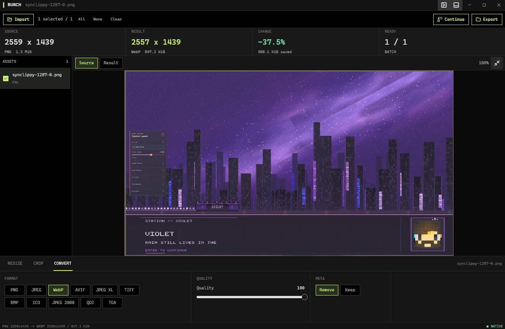

# Bunch of Tools



Bunch of Tools is a local-first project asset workbench. Milestone M2 is in progress. The shared Rust engine drives a real, restricted ImageMagick 7 foundation from both the GPUI desktop and CLI, while the full image workbench workflow and desktop product surface are being completed.

The current desktop loop is intentionally small: import or drop images, Resize, Crop directly on the canvas, Convert, then Export or Continue with the encoded result as the next input. The ImageMagick adapter handles the qualified static formats through a deny-first policy, safe staging, output verification, collision increments, and cancellation without modifying the input. M2 remains open until the revised real-window workflow and visual gates pass.

RAW development is not approximated with generic adjustment sliders. Darktable is the selected future RAW adapter boundary, but no RAW capability is advertised until `darktable-cli` is installed, qualified, and packaged deliberately.

The canonical product, architecture, security, and milestone record is [ADR.md](ADR.md).

## Development

Prerequisites:

- Rust `1.93.1` (selected by `rust-toolchain.toml`);
- ImageMagick 7 available as `magick` on `PATH`, or selected with `BUNCH_IMAGEMAGICK_PATH`;
- the Windows SDK shader compiler (`fxc.exe`) for release GPUI builds.

For a portable ImageMagick installation:

```powershell
$env:BUNCH_IMAGEMAGICK_PATH = 'E:\Tools\ImageMagick\magick.exe'
```

The M2 adapter loads its own deny-first policy from `crates/bunch-native/src/adapters/imagemagick-policy.xml`. It permits only the qualified image coders, denies delegates, filters, indirect reads, and unqualified modules, and applies memory, disk, dimension, frame, thread, and time limits. Every invocation also receives path rules limited to its declared input, staging output, and pixel-cache directory. The system ImageMagick policy is not treated as sufficient.

If `fxc.exe` is not discoverable, set `GPUI_FXC_PATH` for the current shell:

```powershell
$env:GPUI_FXC_PATH = 'C:\Program Files (x86)\Windows Kits\10\bin\10.0.19041.0\x64\fxc.exe'
```

Use the installed SDK version and location on the current machine; the example path is not a repository contract.

```powershell
cargo fmt --all -- --check
cargo check --workspace --all-targets --locked
cargo test --workspace --locked
cargo clippy --workspace --all-targets --locked -- -D warnings
cargo build --release --workspace --locked

cargo run -p bunch-cli -- probe .\input.png
cargo run -p bunch-cli -- image .\input.png
cargo run -p bunch-desktop -- .\input.png
```

The portable contract can be checked independently of the native shell:

```powershell
cargo check -p bunch-core -p bunch-planner -p bunch-protocol `
  --target wasm32-unknown-unknown --locked
```

The shared default recipe produces `{stem}.optimized.webp` beside the input using 1280x720 fit bounds, quality 82, metadata stripping, and an incremented name when the requested output already exists. The desktop initializes resize dimensions from the first source and accepts an optional startup image path as shown above.

`bunch-cli demo` and `foundation.simulate` remain available only as the M1 contract harness. GIF can be safely probed for frame count but is intentionally rejected by the static M2 resize operation; animated image work belongs to M3.

## License

This project is licensed under the [MIT License](LICENSE).
